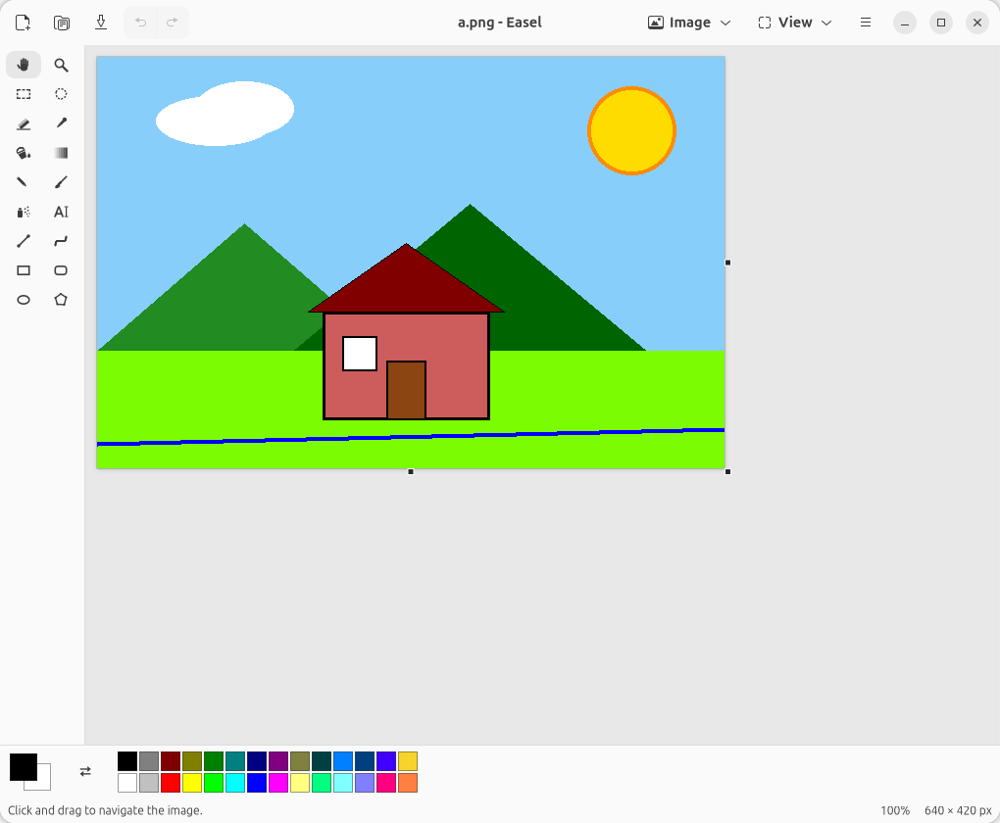
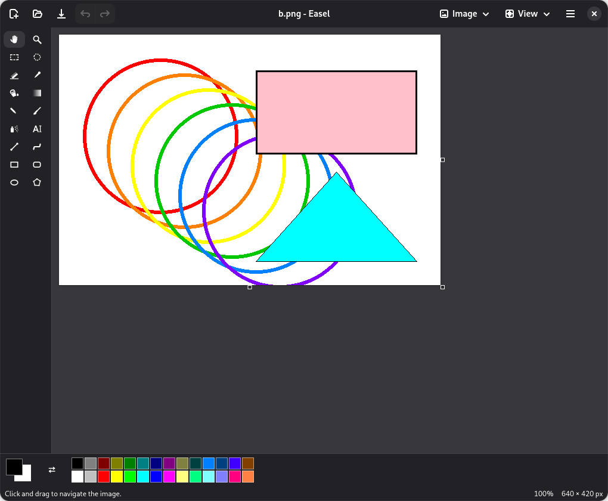

# 🎨 Easel

**Remember the old, beautiful Paint of Windows XP? It's back — and it finally feels at home on GNOME.**

Easel is a native paint program with the functionality and workflow of classic Windows Paint, built from GNOME
components only: **GTK 4 + libadwaita**, written in C, built with Meson. It follows the GNOME look (header bar,
dark mode, dialogs) instead of imitating the Windows 95/XP appearance — same tools you know, in a modern window.

**Version 1.0 — a full release, not a preview.** Every tool works, the edge cases (huge pictures, unsaved-changes
prompts, undo across everything, paste of oversize images, selections on the far side of a panned canvas…) have been
hunted down and fixed. Use it for real: quick sketches, screenshot markup, pixel art, resizing and cropping, or
just drawing a sun in the corner of everything. ☀️

Available in English, Czech, German, Italian, Spanish, Portuguese, Polish, Russian and Ukrainian, with screen-reader labels. Packages: `.deb`, Flatpak and AppImage
(see the [releases](https://github.com/jackal-kr/easel/releases)).

Dark mode too 🌙

## Features
- All the classic tools: Pencil, Brush (12 shapes), Airbrush, Eraser (opaque or transparent, color eraser), Fill,
  Pick Color, Magnifier, Text, Line, Curve, Rectangle, Rounded Rectangle, Ellipse, Polygon, Select, Free-Form Select —
  plus Pan and Gradient.
- Selections with move/copy, clipboard, flip, rotate, stretch/skew, invert; right-click context menus (selection, text, Pan); pasting a larger picture asks to fit it or resize the canvas.
- Unlimited-step undo/redo bounded by memory, zoom 10–800 %, pixel grid, thumbnail, canvas resize handles.
- PNG, JPEG, BMP, TIFF and WebP; GIF can be opened. Printing.
- 28-color palette with editing, Preferences (theme, panels, defaults), keyboard shortcuts window.
- Hard-edged drawing like the original: pixel-exact results.

## Build and run
Requirements: GTK ≥ 4.14, libadwaita ≥ 1.8, gdk-pixbuf 2, GCC or Clang,
Meson, Ninja. Developed on Ubuntu 26.04.

    meson setup build
    ninja -C build
    ./build/src/easel

## Install
Grab the `.deb`, the Flatpak or the AppImage from the [latest release](https://github.com/jackal-kr/easel/releases/latest), or build them yourself into `dist/`:

    tools/check-env.sh              # is everything needed installed?
    tools/build-deb.sh              # dist/easel_<version>_amd64.deb   -> sudo apt install ./dist/easel_*.deb
    tools/build-flatpak.sh          # dist/io.github.jackal_kr.Easel.flatpak -> flatpak --user install dist/*.flatpak
    tools/build-appimage.sh         # dist/Easel-<version>-x86_64.AppImage  -> chmod +x and run it

In VS Code these are tasks: **Terminal → Run Task…** (check environment, build, test, debug, push, packages).

## Test
    meson test -C build --print-errorlogs

Core tests run anywhere. The canvas tests need a display and are skipped without one; headless-friendly:
`GSK_RENDERER=cairo meson test -C build`.

## Documentation
- [User help](docs/help.md) — tools, menus, shortcuts
- [Architecture](docs/architecture.md), [decisions](docs/decisions/), [specs](docs/specs/), [roadmap](docs/roadmap.md)
- [CLAUDE.md](CLAUDE.md) — working rules for contributors using Claude Code

## Project layout
    src/core/   pure C engine: pixels, rasterizer, history, transforms (no GTK)
    src/ui/     GTK/libadwaita: canvas, toolbox, color box, window, dialogs
    data/       menus, GSettings schema, icons, styles
    tests/      core and canvas tests
    tools/      icon generator

## Fun things to try
- Pick the **Airbrush** and spray a cloud — the classic way to make one.
- Choose the **Brush** with the diagonal shape and sign your name like it's 2001.
- Draw something, **Image → Flip/Rotate**, and admire your work upside down.
- Right-click with the **Eraser** to swap one color for another without touching the rest.
- Zoom to 800 % and turn on the pixel grid: instant pixel-art studio.
- Press **F1** for the manual, **Ctrl+Shift+X** to swap colors, **Ctrl+Z** as often as your courage requires.

## Credits and license
Easel is inspired by the old, beautiful Microsoft Paint of Windows XP. Behavior of the classic tools was also studied from [jspaint](https://github.com/1j01/jspaint) (MIT); Easel contains
none of its code. Easel is licensed under the GPL-3.0-or-later — see [LICENSE](LICENSE).
